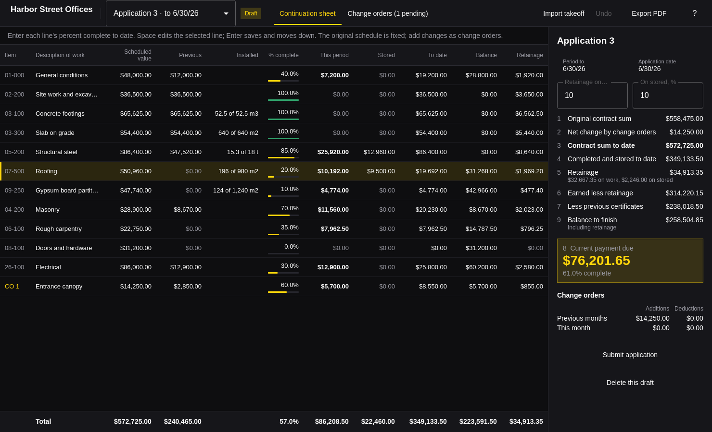

# Spire

Progress billing for contractors, for [Omarchy](https://omarchy.org). Set up
the schedule of values, enter each line's percent complete every period, and
export the pay application, the application and certificate for payment with
its continuation sheet in the familiar G702/G703 format, as a PDF.



- **Schedule of values.** Type in the lines of work with their scheduled
  values, or import them from a Plumb takeoff, with quantities and unit prices.
- **Bill each period.** Enter percent complete to date per line; what was
  billed before, this period, to date, the balance, and retainage follow.
  Amounts for this period, materials stored, and installed quantities can be
  typed in instead.
- **Retainage** on completed work and on stored materials, at rates each
  application keeps for itself, so reducing retainage later releases it.
- **Change orders** wait as pending until approved, and are billed like any
  other line from the application they were approved on. The certificate's
  change order summary splits them by month, additions and deductions.
- **Applications are fixed once submitted.** After the first one, the
  original schedule is locked and changes go through change orders. The
  latest application can be reopened if something has to change.
- **Export the pay application** as a PDF: the certificate with its nine
  lines and signature blocks, then the continuation sheet, on Letter or A4
  paper depending on the language.
- **One file per project.** A `.spire` file is a SQLite database holding the
  whole project, saved as you go, with undo for every change.

Spire follows the Omarchy theme accent, window rounding, and language as they
change, in English, Danish, German, Spanish, French, and Hebrew.

## Keyboard

| Key | Action |
| --- | --- |
| Space | Edit the selected line's percent complete |
| Enter | Save and move down, as in a spreadsheet |
| Tab / Shift + Tab | Save and move across |
| Esc | Put the value back, then deselect |
| ↑ ↓ or J K | Previous or next line |
| F | Bill the line in full |
| A | Add a line (or a change order on that page) |
| Alt + ↑ ↓ | Move the line up or down |
| Delete | Delete the line |
| C | Add a change order |
| 1 2 | Continuation sheet, change orders |
| [ ] | Previous or next application |
| N | Start the next application |
| I | Import a Plumb takeoff |
| Ctrl + E | Export the pay application |
| Ctrl + , | Project details |
| Ctrl + N / Ctrl + O | New or open project |
| Ctrl + Z / Ctrl + Shift + Z | Undo, redo |
| ? | Show every shortcut |
| Q | Quit |

Click any value with a frame on hover to edit it in place.

## Plumb takeoffs

Spire reads the CSV that Plumb exports. Columns are found by their headings,
in any order, with commas, semicolons, or tabs between them and numbers
written either `1,234.50` or `1.234,50`:

| Heading | Also read as | Used for |
| --- | --- | --- |
| Code | Item, Item no., Cost code | Matching lines |
| Description | Name, Element | Matching lines, naming new ones |
| Quantity | Qty, Takeoff | The line's quantity |
| Unit | UoM | m², t, ls, … |
| Unit price | Rate, Unit cost | Scheduled value = quantity × unit price |
| Amount | Total, Value | Scheduled value, when there is no unit price |
| Installed | Installed to date, Completed | Percent complete this period |

An item measured on several sheets is added up. Lines are matched by code,
then by description; matching lines get the new quantities and prices, and
new items are added while the schedule of values is still open. With an
Installed column, the open application is billed by quantity. Spire shows
what each row would do before anything changes.

## Command line

Every command works on a project without a window, takes `--json`, and exits
0 or 1 with errors on stderr.

```sh
spire new job.spire --name "Harbor Street" --owner "Harbor Holdings" --retainage 10
spire import job.spire takeoff.csv --dry-run
spire add-line job.spire --code 01-000 --description "General conditions" --scheduled 48000
spire start job.spire --period-to 2026-04-30
spire bill job.spire 05-200 --percent 85
spire bill job.spire 07-500 --stored 9500
spire change-order job.spire --description "Entrance canopy" --amount 14250 --approve
spire summary job.spire
spire export job.spire application-3.pdf
spire submit job.spire
spire open job.spire
```

`spire help` lists every command. `spire skill install` installs a short
skill so coding agents know how to use them.

## Build

Needs `qmake6`, `make`, a C++ compiler, and Qt 6 (base, declarative,
wayland), all of which come with Omarchy.

```sh
bin/build      # build/spire
bin/test       # tests, including the real window driven offscreen
bin/install    # builds and installs the package, so Spire is in the launcher
```

## License

MIT
